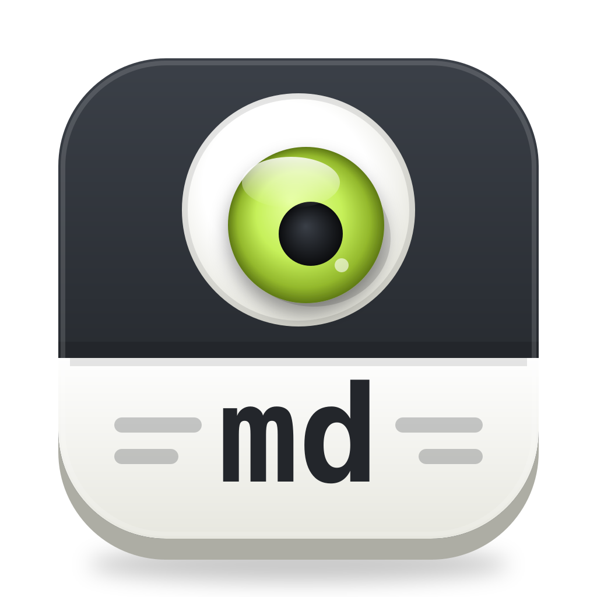

<p align="center">
  
</p>

# mdpeek

A native macOS viewer for Markdown files with embedded Mermaid diagrams, rendered the way GitHub renders them.

- GitHub Flavored Markdown via [cmark-gfm](https://github.com/swiftlang/swift-cmark) (the parser GitHub uses): tables, task lists, footnotes, autolinks, alerts (`> [!NOTE]`), heading anchors, syntax highlighting, sanitized raw HTML.
- ```` ```mermaid ```` blocks are rendered as diagrams in colors matching the page. Hover a diagram to copy it as SVG, show its source, or open it full window. A diagram that fails to parse shows its source with line numbers, the error message, and the offending line/token highlighted; the rest of the document renders normally.
- Code blocks show their language and a Copy button.
- Reloads automatically when the file changes (including atomic saves by editors such as vim or VS Code), keeping the scroll position anchored to the content you were looking at, and the zoom level. A short notice confirms each reload.
- Editor pane (⌃⌘E or the toolbar button): Neovim, bundled with the app, running in a terminal next to the preview with your own configuration (`~/.config/nvim`, plugins, keybindings, Vimscript or Lua). It starts through your login shell, so plugins find the same tools as in your terminal. The preview reloads when you save. The editor and the preview scroll together, whichever you scroll, and the editor opens where you are reading; a diagram corresponds to the lines of its source. Files you open in mdpeek open in Neovim too, and zooming scales its text along with the preview. Click Linked in the status bar (or View › Link Editor and Preview) to unlink them: they then scroll independently, and zooming applies to whichever has focus. Linking them again brings the other one to the zoom level and position of the one you were working in. Quitting Neovim closes the pane, and mdpeek asks before discarding unsaved changes.
- Sidebar (⌃⌘S or the toolbar button) with an Outline | Files switch. Outline (the default once a document is open) lists its headings, marks the section you are reading with a lime dot, and jumps to a heading when you click it. Files lists recently opened files; right-click one to show it in Finder or remove it. The filter field filters whichever list is shown.
- A slim toolbar: Find (⌘F, ⌘G / ⇧⌘G), the editor toggle, and a More menu with Open in Editor (⌥⌘O, the default app for the file other than mdpeek), Share, Export as PDF (⇧⌘E) and Print (⌘P). Zoom with ⌘+ / ⌘− / ⌘0, the View menu or the status bar.
- Status bar below the preview (and the editor) with word count, reading time and the current section, the zoom control (− 100% +), and, while the editor is shown, the Linked toggle.
- A start page while no file is open: drop a file on the window or use Open File….
- Light and dark mode follow the system.

## Installation

### Download

Download `mdpeek.zip` from the [latest release](https://github.com/hafenr/mdpeek/releases/latest) (Apple Silicon, macOS 15 or later), unzip it, and move `mdpeek.app` to `~/Applications`. The app is not notarized by Apple, so macOS refuses to open the downloaded copy until you remove the quarantine flag:

```sh
xattr -dr com.apple.quarantine ~/Applications/mdpeek.app
```

### Build from source

Requirements: macOS 15 or later, the Swift toolchain (Xcode, or the Command Line Tools via `xcode-select --install`), Node.js with npm, and curl (`build.sh` downloads the Neovim release it bundles).

1. Build the app from the project directory:

   ```sh
   ./build.sh          # produces build/mdpeek.app
   ```

2. Install it and open it once, so macOS registers it for Finder's "Open With" and the command-line launcher:

   ```sh
   cp -R build/mdpeek.app ~/Applications/
   open ~/Applications/mdpeek.app
   ```

   Use `/Applications` instead to install it for all users.

3. Optionally, install the `mdpeek` command:

   ```sh
   mkdir -p ~/.local/bin
   ln -s "$PWD/bin/mdpeek" ~/.local/bin/mdpeek
   ```

   `~/.local/bin` must be on your `PATH` (e.g. add `export PATH="$HOME/.local/bin:$PATH"` to `~/.zshrc`). The command is a link into this checkout, so keep the checkout where it is.

4. Optionally, make mdpeek the default app for Markdown files: select a `.md` file in Finder, choose File › Get Info (⌘I), pick mdpeek under "Open with", and click Change All….

### Updating

Quit mdpeek, then rebuild and replace the installed app:

```sh
./build.sh && rm -rf ~/Applications/mdpeek.app && cp -R build/mdpeek.app ~/Applications/
```

### Uninstalling

```sh
rm -rf ~/Applications/mdpeek.app ~/.local/bin/mdpeek
defaults delete dev.mdpeek    # recent files and window layout
```

### Releasing

Push a version tag. The Package workflow builds the app with that version and publishes a GitHub release with `mdpeek.zip`:

```sh
git tag v0.2.0 && git push origin v0.2.0
```

## Usage

```sh
mdpeek README.md
```

Or use File › Open… (⌘O), drop a file on the Dock icon, or pick mdpeek from Finder's "Open With". Zoom with ⌘+ / ⌘- / ⌘0 or pinch. Links to other Markdown files open in mdpeek; other links open in the default app.

## Layout

- `Sources/mdpeek` – the AppKit app: window with sidebar, `WKWebView` preview, FSEvents file watcher, cmark-gfm rendering, and the editor pane ([SwiftTerm](https://github.com/migueldeicaza/SwiftTerm) running Neovim).
- `Resources/mdpeek.lua` – loaded into the editor's Neovim; reports its scroll position, unsaved changes and background color to mdpeek over a Unix socket, and opens and scrolls to what mdpeek shows. The Neovim release is pinned in `build.sh`.
- `Resources/AppIcon.icns`, `Resources/icon/` – the app icon and its SVG sources; `scripts/make_icon.py` regenerates them.
- `Resources/web` – the page that displays the rendered HTML (`mdpeek.js` handles sanitizing, alerts, highlighting, Mermaid, and scroll preservation). Its third-party libraries are pinned in `package.json` and copied into the app bundle by `build.sh`.
